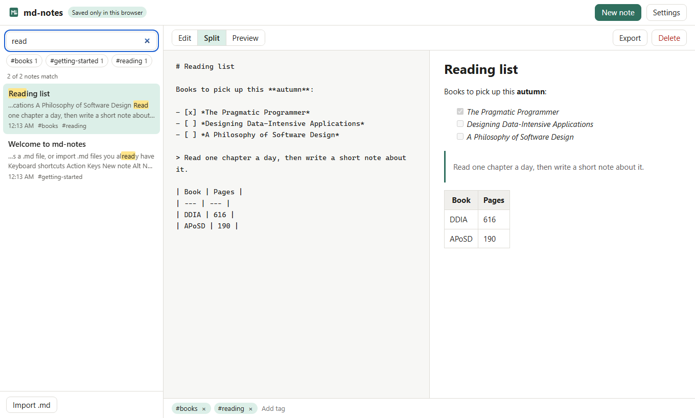

# md-notes

md-notes is a note-taking app that runs entirely in your web browser. You write
notes in Markdown, a simple way of formatting text with symbols like `#` for a
heading and `**` for bold, and see the formatted result next to what you type.
Your notes are saved on your own device as you type. There is no account, no
sign-in and no server that receives your writing.

**Try it:** [md-notes-mu.vercel.app](https://md-notes-mu.vercel.app)



[](https://github.com/Mdjamilh/md-notes/actions/workflows/ci.yml)

## Where your notes live

This is the most important thing to know about the app, so it comes first.

| Question | Answer |
| --- | --- |
| Where are notes stored? | In IndexedDB, a database built into your browser, on your device. |
| Does the website see them? | No. The site is static files. It has no backend, no analytics and no cookies. |
| What if I clear my browser data or switch browsers? | The notes are gone from that browser. Use **Export** to keep `.md` copies. |
| Do notes sync between devices? | No. That is a deliberate trade-off for keeping everything local. |
| Is anything ever sent anywhere? | Only if you turn on the optional local AI and press **Summarize**. Even then it goes to a server on your own computer (see below). |

The hosted site sends a strict Content Security Policy (see [`vercel.json`](vercel.json)):
scripts only from the site itself, and network calls only to the site and to
`localhost:11434` / `127.0.0.1:11434` for the optional Ollama feature. Even if
a bug let injected code run, the browser would refuse its requests to any other
server. (Images from `https:` addresses are allowed so notes can show pictures;
see Known limits.)

## What you can do

- **Write with a live preview.** A side-by-side view on wide screens. On a phone
  you switch between Edit and Preview with a button. Tables, task lists and code
  blocks render the way GitHub renders them (GitHub Flavoured Markdown).
- **Search everything.** The search box matches note titles, text and tags as you
  type, highlights matches in the list, and ranks title matches first. Quotes
  search for a phrase (`"next week"`), and `tag:work` or `#work` filters by tag.
- **Tag notes.** Add tags under the editor, then click a tag in the sidebar to
  filter by it.
- **Autosave.** Edits are written to the browser database a moment after you stop
  typing, and straight away if you switch tabs or close the page. The toolbar
  shows "Saving..." and "Saved", and shows a warning if the browser refuses the
  write (for example, when storage is full).
- **Export and import.** Export downloads a note as a `.md` file with its tags and
  dates in a small header (YAML front matter, the format Obsidian, Jekyll and
  Hugo use). Import accepts one or more `.md`, `.markdown` or `.txt` files and
  reads that header if present.
- **Keyboard shortcuts.**

  | Action | Keys |
  | --- | --- |
  | New note | <kbd>Alt</kbd> + <kbd>N</kbd> |
  | Search | <kbd>Ctrl/Cmd</kbd> + <kbd>K</kbd>, or <kbd>/</kbd> outside a text box |
  | Toggle preview | <kbd>Alt</kbd> + <kbd>P</kbd> |
  | Save now | <kbd>Ctrl/Cmd</kbd> + <kbd>S</kbd> |

  Ctrl+N and Ctrl+P belong to the browser (new window, print) and cannot be
  taken over reliably, which is why those two use Alt.
- **Light and dark themes.** Follows your device by default; you can pick one in
  Settings.

## The optional local AI summary

**The demo site has no AI.** There is no model on the server and no API key in
the code. What the app offers instead is a button that asks a model running on
*your own computer* to summarize the open note.

How it works:

1. You install [Ollama](https://ollama.com) and download a model:
   `ollama pull llama3.2`.
2. In md-notes, open **Settings** and tick "Show the Summarize (local) button".
   It is off by default. The URL defaults to `http://localhost:11434` and the
   model to `llama3.2`; both can be changed.
3. Pressing **Summarize (local)** makes your browser send the note text directly
   to `http://localhost:11434/api/generate`. The request never passes through
   md-notes' hosting. The summary appears in a panel, and you can insert it into
   the note or throw it away.

To use it from the hosted site, Ollama has to accept requests from that site.
Start it with `OLLAMA_ORIGINS=https://md-notes-mu.vercel.app ollama serve`.
Recent versions of Chrome may also ask for permission to reach devices on your
local network. The hosted site's security policy only allows `localhost:11434`
and `127.0.0.1:11434`; to point it at another machine, run md-notes yourself.

If Ollama is not running, the model is not installed or the request times out,
the panel says so in plain words (for example "Could not reach Ollama at
http://localhost:11434. Make sure it is running...") with a Try again button.
**Test connection** in Settings checks the server and lists installed models.

What the model's answer is good for: a rough first pass. Small local models get
things wrong. Read the summary before you keep it.

## How it is built

Vue 3 (Composition API with `<script setup>`), Pinia, Vite 7 and TypeScript in
strict mode, with plain CSS and no UI framework.

```
src/
  lib/            framework-free logic, each file unit-tested
    notes.ts        note type, title from the first line, tag normalization
    search.ts       query parsing, ranking, snippets
    highlight.ts    splits text into matched / unmatched segments
    markdown.ts     marked + DOMPurify
    transfer.ts     .md export with front matter, import, download
    storage.ts      IndexedDB through idb-keyval
    ollama.ts       the optional local-model client
  stores/         Pinia: notes (autosave, selection, filters) and settings
  composables/    keyboard shortcuts, theme, media query
  components/     NoteList, NoteEditor, MarkdownPreview, TagEditor,
                  SummaryPanel, SettingsDialog, HighlightedText
```

A few decisions worth knowing about:

- **The title is not a separate field.** It is taken from the first line of the
  note, so there is only one thing to edit and nothing to get out of sync.
- **Rendered Markdown is sanitized.** Markdown allows raw HTML, and imported
  files are untrusted, so the output of `marked` always goes through DOMPurify
  before it reaches the page. Event handlers (`onerror`, `onclick`...),
  `<script>`, `javascript:` links, iframes, forms and inline styles are removed,
  and links open in a new tab without access to this one.
- **Search highlighting never uses HTML.** Matches are returned as text segments
  and rendered as `<mark>` elements by the Vue template. Note text can't become
  markup in the list, whatever it contains.
- **Saving is debounced per note** (400 ms), and pending writes are flushed when
  the page is hidden.

## How it is tested

```
npm test           # 99 unit and component tests (Vitest, jsdom, fake-indexeddb)
npm run test:e2e   # Playwright, desktop and phone-sized Chrome
```

- **Search and highlight:** phrases, tag filters, AND matching, ranking, regex
  characters treated literally, non-ASCII text, snippets.
- **Sanitizing:** proves that ``, `<script>`, `svg
  onload`, `javascript:` links, iframes, forms and inline styles are stripped,
  checked on the parsed DOM rather than by string matching.
- **Import and export:** exact output format, a full round trip, YAML list tags,
  Windows line endings and byte-order marks, wrong file types and oversized files.
- **Store and storage:** first-visit welcome note, autosave timing, flush,
  delete with a pending save, storage failure reporting, malformed records in
  the database, Vue reactive objects stored as plain data.
- **Ollama client:** request shape, unreachable server, missing model, server
  errors, malformed replies, cancel.
- **Browser smoke test:** create a note, type Markdown, see the preview, reload
  and find it again; search highlighting; the local-AI flow with Ollama
  unavailable. `vite preview` serves the same security headers as production,
  so the browser tests fail if the CSP would break the deployed app.

CI on GitHub Actions runs lint, the type check (`vue-tsc`), the unit tests, a
production build, `npm audit --audit-level=high`, and the Playwright tests in
the official Playwright container.

## Run it yourself

You need Node.js 22.

```
git clone https://github.com/Mdjamilh/md-notes.git
cd md-notes
npm ci
npm run dev        # http://localhost:5173
```

Other scripts: `npm run build`, `npm run preview`, `npm run lint`,
`npm run typecheck`. For the browser tests, run `npx playwright install chromium`
once; the tests build the app and serve it on port 47220.

When you run it locally, the local AI works with any Ollama address, as long as
Ollama's `OLLAMA_ORIGINS` includes the address you open md-notes on.

## Known limits

- No sync, no sharing and no version history. One browser, one set of notes.
- Search is substring matching. It does not stem words or forgive typos, and
  "read" also matches "already".
- Images are linked, not stored. A note can show an image from a web address,
  but you cannot paste or upload one, and showing it means your browser loads
  it from that address.
- Deleting a note asks for confirmation but cannot be undone.
- Export works one note at a time.

## License

[MIT](LICENSE)
